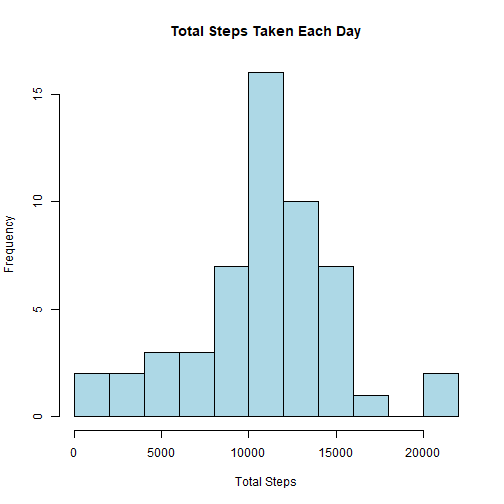
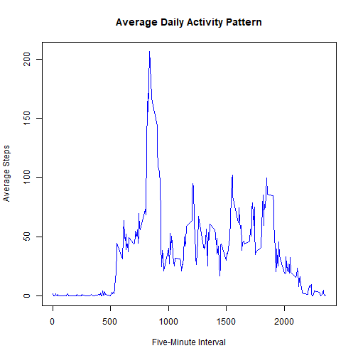
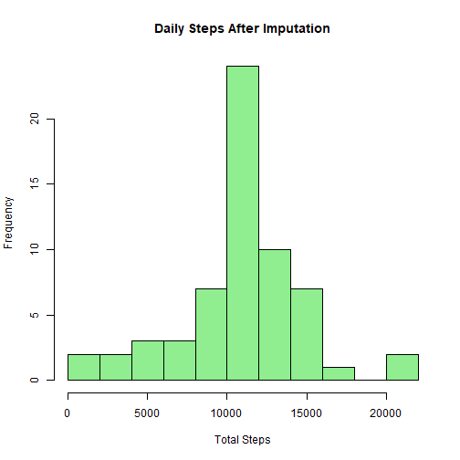
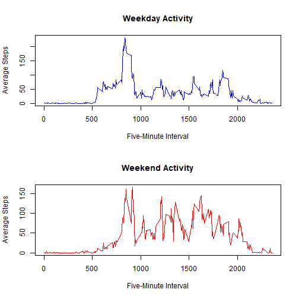

## Loading and preprocessing the data


``` r
activity <- read.csv("activity.csv")
activity$date <- as.Date(activity$date)

head(activity)
```

```
##   steps       date interval
## 1    NA 2012-10-01        0
## 2    NA 2012-10-01        5
## 3    NA 2012-10-01       10
## 4    NA 2012-10-01       15
## 5    NA 2012-10-01       20
## 6    NA 2012-10-01       25
```

``` r
str(activity)
```

```
## 'data.frame':	17568 obs. of  3 variables:
##  $ steps   : int  NA NA NA NA NA NA NA NA NA NA ...
##  $ date    : Date, format:  ...
##  $ interval: int  0 5 10 15 20 25 30 35 40 45 ...
```


## What is mean total number of steps taken per day?


``` r
daily_steps <- aggregate(
  steps ~ date,
  data = activity,
  FUN = sum,
  na.rm = TRUE
)

hist(daily_steps$steps,
     main = "Total Steps Taken Each Day",
     xlab = "Total Steps",
     breaks = 10,
     col = "lightblue")
```



``` r
mean(daily_steps$steps)
```

```
## [1] 10766.19
```

``` r
median(daily_steps$steps)
```

```
## [1] 10765
```


## What is the average daily activity pattern?


``` r
interval_steps <- aggregate(
  steps ~ interval,
  data = activity,
  FUN = mean,
  na.rm = TRUE
)

plot(interval_steps$interval,
     interval_steps$steps,
     type = "l",
     main = "Average Daily Activity Pattern",
     xlab = "Five-Minute Interval",
     ylab = "Average Steps",
     col = "blue")
```



``` r
max_row <- which.max(interval_steps$steps)
interval_steps[max_row, ]
```

```
##     interval    steps
## 104      835 206.1698
```


## Imputing missing values


``` r
# Count missing values
sum(is.na(activity$steps))
```

```
## [1] 2304
```

``` r
# Calculate average steps for each interval
interval_means <- aggregate(
  steps ~ interval,
  data = activity,
  FUN = mean,
  na.rm = TRUE
)

# Make a copy of the original dataset
activity_imputed <- activity

# Replace missing values with interval averages
missing_rows <- is.na(activity_imputed$steps)

activity_imputed$steps[missing_rows] <-
  interval_means$steps[
    match(
      activity_imputed$interval[missing_rows],
      interval_means$interval
    )
  ]

# Confirm that no missing values remain
sum(is.na(activity_imputed$steps))
```

```
## [1] 0
```

``` r
# Calculate daily totals after imputation
daily_steps_imputed <- aggregate(
  steps ~ date,
  data = activity_imputed,
  FUN = sum
)

# Plot the new daily totals
hist(daily_steps_imputed$steps,
     main = "Daily Steps After Imputation",
     xlab = "Total Steps",
     breaks = 10,
     col = "lightgreen")
```



``` r
# Calculate new mean and median
mean(daily_steps_imputed$steps)
```

```
## [1] 10766.19
```

``` r
median(daily_steps_imputed$steps)
```

```
## [1] 10766.19
```


## Are there differences in activity patterns between weekdays and weekends?


``` r
# Classify each date
activity_imputed$day_type <- ifelse(
  weekdays(activity_imputed$date) %in%
    c("Saturday", "Sunday"),
  "weekend",
  "weekday"
)

activity_imputed$day_type <- factor(
  activity_imputed$day_type,
  levels = c("weekday", "weekend")
)

# Count observations by day type
table(activity_imputed$day_type)
```

```
## 
## weekday weekend 
##   12960    4608
```

``` r
# Calculate average steps by interval and day type
activity_pattern <- aggregate(
  steps ~ interval + day_type,
  data = activity_imputed,
  FUN = mean
)

# Separate weekday and weekend data
weekday_data <- subset(
  activity_pattern,
  day_type == "weekday"
)

weekend_data <- subset(
  activity_pattern,
  day_type == "weekend"
)

# Create the two-panel plot
par(mfrow = c(2, 1))

plot(weekday_data$interval,
     weekday_data$steps,
     type = "l",
     main = "Weekday Activity",
     xlab = "Five-Minute Interval",
     ylab = "Average Steps",
     col = "blue")

plot(weekend_data$interval,
     weekend_data$steps,
     type = "l",
     main = "Weekend Activity",
     xlab = "Five-Minute Interval",
     ylab = "Average Steps",
     col = "red")
```



``` r
par(mfrow = c(1, 1))
```

